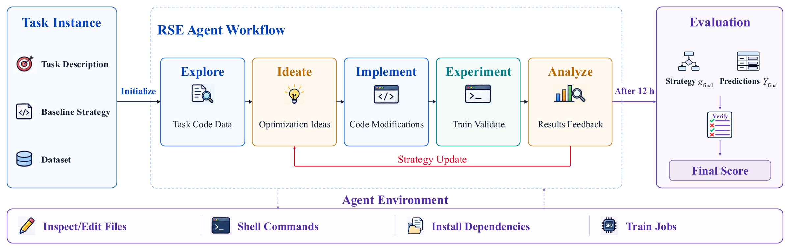

<div align="center">


<p>
  <a href="https://arxiv.org/abs/2610.37228"></a>
  <a href="https://ray-tiann.github.io/AutoRSE_WEB/"></a>
  <a href="https://huggingface.co/spaces/Ray0311/AutoRSE-Leaderboard"></a>
</p>

</div>

AutoRSE serves as **the first platform to assess** how LLM-driven agents autonomously refine six recommendation baselines via code-level changes and empirical experimentation, leveraging the [Harbor](https://harborframework.com/) framework.

## 🧭 Workflow

1. **Task setup.** Each run starts with a baseline implementation, task instructions, and public training, validation, and unlabeled test inputs. The agent works in a container with file-editing tools, shell access, dependency installation, and one visible GPU.

2. **Research loop (12 hours).** The agent explores the code and data, proposes improvements, implements changes, trains, and analyzes validation results to plan the next experiment. Each logical experiment uses a Git branch; both successful and failed outcomes are recorded.

3. **Final selection and export.** The agent selects its best candidate using public validation and restores the matching test predictions. It exports the selected code, helpers, configuration, Git history, and prediction hashes to `/workspace/artifact/`; the agent trajectory is retained separately.

4. **Hosted evaluation.** After completing all six tasks, package their predictions into one ZIP and upload it to the Hugging Face evaluator. The service returns task metrics such as NDCG@10 or AUC and a signed receipt. Hidden labels stay private, and hidden-test feedback must not guide research or selection.



## 🚀 Quickstart

**Requirements:** Linux · one NVIDIA GPU · CUDA 12.1-compatible driver · Docker + NVIDIA Container Toolkit · Python 3.12 · Bash.

### 1. Install

```bash
git clone https://github.com/Ray-Tiann/AutoRSE.git
cd AutoRSE
python3.12 -m venv .venv
source .venv/bin/activate
python -m pip install -r requirements.txt -r requirements-harbor.txt
bash tools/build_images.sh
```

### 2. Download the data

```bash
python tools/install_public_data.py --repo-id Ray0311/AutoRSE
```

To install from a local copy of the reviewed v2 ZIP:

```bash
python tools/install_public_data.py --archive /path/to/recagent-data-public-v2.zip
```

### 3. Configure your model

Create a private credential file outside the repository:

```bash
mkdir -p "$HOME/.config/autorse"
${EDITOR:-vi} "$HOME/.config/autorse/provider.env"
chmod 600 "$HOME/.config/autorse/provider.env"
```

For an OpenAI-backed Terminus-2 run, put this in the file and replace the value:

```dotenv
OPENAI_API_KEY=YOUR_API_KEY
```

Set the agent's LLM model ID, credential-file path, and a run label:

```bash
export AUTORSE_MODEL="openai/YOUR_MODEL_ID"
export AUTORSE_API_ENV="$HOME/.config/autorse/provider.env"
export AUTORSE_RUN_LABEL="my-agent-v1"
export AUTORSE_SEED=2024
```

For other providers or harnesses, use their supported model IDs and credential variables.

### 4. Choose and run your agent

**Choose one** in the same Bash session:

```bash
# A. Use the supplied Terminus-2 harness
AUTORSE_AGENT_ARGS=(--agent terminus-2)
```

```bash
# B. Use your own agent; replace the shipped example with your module:Class
AUTORSE_AGENT_ARGS=(--agent-import-path custom_agents.evidence_agent:EvidenceAgent)
```

First check the launch command; this starts no agent or training:

```bash
python tools/run_agent.py --task hstu "${AUTORSE_AGENT_ARGS[@]}" \
  --model "$AUTORSE_MODEL" --api-env-file "$AUTORSE_API_ENV" \
  --gpu 0 --seed "$AUTORSE_SEED" --dry-run
```

Run all six tasks sequentially, using one GPU:

```bash
for AUTORSE_TASK in hstu intsr tiger onetrans rankmixer wukong; do
  python tools/run_agent.py --task "$AUTORSE_TASK" "${AUTORSE_AGENT_ARGS[@]}" \
    --model "$AUTORSE_MODEL" --api-env-file "$AUTORSE_API_ENV" \
    --gpu 0 --seed "$AUTORSE_SEED" \
    --jobs-dir ./runs --job-name "${AUTORSE_RUN_LABEL}-${AUTORSE_TASK}-s${AUTORSE_SEED}" || break
done
```

- Default: **12 hours of research + up to 300 seconds of finalization per task**.
- Change `AUTORSE_RUN_LABEL` for a new agent/configuration or rerun. To try one task first, replace the loop's task list with `hstu`.
- Custom harnesses must honor the same budget. Select on public validation; no hidden-test feedback, external knowledge banks, or historical experiment cards.

### 5. Validate and package the predictions

Validate the six collected predictions and create the evaluator ZIP:

```bash
python tools/package_predictions.py --runs-dir ./runs \
  --run-label "$AUTORSE_RUN_LABEL" --seed "$AUTORSE_SEED"
```

The command refuses missing or ambiguous trials. Upload the ZIP filename it prints.

Local validation checks **format only**. Keep the selected source `artifact/`, agent logs, and configuration under `runs/` for reproduction.

### 6. Get the official score

1. Open [AutoRSE Evaluator](https://huggingface.co/spaces/Ray0311/AutoRSE-Evaluator) and sign in.
2. Upload the ZIP printed by step 5 and click **Evaluate all six tasks**.
3. Download the signed JSON receipt and keep it with your run evidence.

Only predictions go in this ZIP. Source code, Git bundles, and logs stay in the separate evidence package.

## 🏆 Submit to the leaderboard

- Run **three independent trials per task** with three distinct seeds: **18 research runs**.
- For the next trial, change `AUTORSE_SEED` and repeat steps 4–6. Keep the same versioned agent/model configuration.
- Publish each run's evidence and follow the submission commands in [submission guide](https://github.com/Ray-Tiann/AutoRSE_WEB/blob/main/leaderboard/SUBMIT.md).

## 📊 Results

We evaluated seven agent configurations across three harnesses—Claude Code, Codex, and Terminus-2—and three LLMs—DeepSeek V4 Flash, Claude Opus 4.8, and GPT-5.5—on all six recommendation tasks, with a 12-hour research budget per task. The results are shown below as mean ± standard deviation; **bold** marks the highest mean in each task.

| Harness | Model | HSTU<br>NDCG@10 ↑ | IntSR<br>Macro NDCG@10 ↑ | TIGER<br>NDCG@10 ↑ | OneTrans<br>Click AUC ↑ | RankMixer<br>AUC ↑ | WuKong<br>AUC ↑ |
| :--- | :--- | ---: | ---: | ---: | ---: | ---: | ---: |
| Baseline | — | 0.0535 | 0.6940 | 0.0332 | 0.6767 | 0.7859 | 0.9645 |
| Claude Code | DeepSeek V4 Flash | 0.0674 ± 0.0032 | 0.6606 ± 0.0541 | 0.0476 ± 0.0138 | **0.7467** ± 0.0324 | 0.7979 ± 0.0015 | 0.9805 ± 0.0030 |
| Claude Code | Claude Opus 4.8 | **0.0754** ± 0.0043 | 0.7325 ± 0.0292 | 0.0631 ± 0.0164 | 0.7184 ± 0.0068 | **0.8002** ± 0.0009 | 0.9840 ± 0.0039 |
| Codex | DeepSeek V4 Flash | 0.0657 ± 0.0030 | 0.6485 ± 0.0335 | 0.0583 ± 0.0147 | 0.7203 ± 0.0044 | 0.7974 ± 0.0003 | 0.9790 ± 0.0018 |
| Codex | GPT-5.5 | 0.0672 ± 0.0065 | **0.7692** ± 0.1904 | **0.0659** ± 0.0046 | 0.7292 ± 0.0342 | 0.7954 ± 0.0030 | 0.9796 ± 0.0032 |
| Terminus-2 | DeepSeek V4 Flash | 0.0667 ± 0.0057 | 0.6291 ± 0.0858 | 0.0554 ± 0.0158 | 0.6665 ± 0.0447 | 0.7977 ± 0.0012 | **0.9877** ± 0.0020 |
| Terminus-2 | GPT-5.5 | 0.0697 ± 0.0058 | 0.6146 ± 0.0711 | 0.0614 ± 0.0053 | 0.7285 ± 0.0498† | 0.7944 ± 0.0021 | 0.9749 ± 0.0035 |
| Terminus-2 | Claude Opus 4.8 | 0.0636 ± 0.0015 | 0.6761 ± 0.0334 | 0.0273 ± 0.0190 | 0.7207 ± 0.0232 | 0.7989 ± 0.0014 | 0.9823 ± 0.0004 |

Agent results use three trials, except † OneTrans with Terminus-2 × GPT-5.5, which uses two. These are historical paper results, **not re-evaluations on the current public v2 data**.

Code: Apache-2.0. Dataset and third-party terms remain with their original sources.
