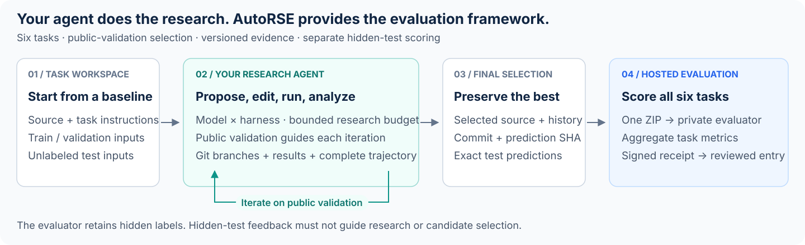

<div align="center">


<p><b>Bring your agent. Run recommendation research. Evaluate with reproducible evidence.</b></p>

<p>
  <a href="https://huggingface.co/datasets/RayTian/AutoRSE"></a>
  <a href="https://huggingface.co/spaces/Ray0311/AutoRSE-Evaluator"></a>
  <a href="https://huggingface.co/spaces/Ray0311/AutoRSE-Leaderboard"></a>
</p>

<p>
  <a href="https://github.com/Ray-Tiann/AutoRSE/actions/workflows/checks.yml"></a>
  
  <a href="LICENSE"></a>
</p>

<p>
  <a href="#how-it-works">How it works</a> ·
  <a href="#tasks">Tasks</a> ·
  <a href="#run-your-agent">Run your agent</a> ·
  <a href="#submit-results">Submit results</a> ·
  <a href="docs/CUSTOM_AGENTS.md">Custom agent guide</a>
</p>

</div>

**AutoRSE is an evaluation framework for autonomous recommendation research agents.**
It gives your agent an editable recommendation baseline, public data, and a task
workspace. The agent proposes improvements, changes code, runs experiments, and
selects a final candidate using public validation. AutoRSE records the research
process and evaluates the final predictions through a separate hidden-test service.

Use a supplied harness with your own supported model, customize the provided
research-agent example, or connect your own Harbor-compatible agent.
Research runs on your Linux/GPU machine; Hugging Face hosts prediction scoring
and the leaderboard.

| | What the framework provides |
|---|---|
| 🧪 **Research tasks** | Six editable recommendation baselines, task instructions, and public train/validation/test inputs. |
| 🔌 **Agent integration** | Claude Code, Codex, Terminus-2, and a Python import path for your own agent. |
| ⏱️ **Bounded trials** | A default 12-hour research window, up to 300 seconds of finalization, and one visible GPU. |
| 🧾 **Reproducible evidence** | Git experiment branches, run records, selected source, prediction hashes, and agent trajectories. |
| 🏆 **Hosted evaluation** | Six-task hidden-test metrics, signed receipts, and a reviewed community leaderboard. |

<a name="how-it-works"></a>

## 🧭 How it works



1. **Create a task workspace.** Harbor starts the task container with baseline code,
   public inputs, and instructions. Your agent reads and edits files and runs tools
   in that workspace.
2. **Run the research loop.** The agent designs changes, commits each experiment on
   its own Git branch, trains, and interprets **public-validation** results. The
   supplied persistent adapters keep the same native session working until the
   research deadline, then enter finalization.
3. **Preserve and evaluate the selection.** The agent restores its best branch and
   matching prediction, exports its source/history artifact, and finishes. Participants
   then upload the six-task prediction ZIP to the hosted evaluator and retain its
   signed receipt with the run evidence.

**Public validation drives research. Hidden-test scores must never guide candidate
selection.** The local verifier checks prediction format; the hosted evaluator
retains hidden labels and computes the official metrics. Custom harnesses must
preserve the trial budget, complete logs, and finalization contract described in
[Runtime instructions](benchmark/RUNTIME.md).

<a name="tasks"></a>

## 🧪 Recommendation tasks

| Task | Data | Research setting | Main hosted metric ↑ |
|---|---|---|---|
| HSTU | Amazon Beauty | Sequential recommendation | NDCG@10 |
| TIGER | Amazon Beauty | Generative recommendation | NDCG@10 |
| IntSR | Amazon | Recommendation and search | Macro NDCG@10 |
| OneTrans | KuaiSAR v2 | Click-through rate prediction | AUC |
| RankMixer | Criteo 5M | Click-through rate prediction | AUC |
| WuKong | MovieLens | Click-through rate prediction | AUC |

See the [dataset card](docs/DATASET.md) for splits, identities, v2 changes, and
upstream data terms. Each [task directory](benchmark/tasks) defines the model
constraints, input layout, and required prediction schema.

<a name="run-your-agent"></a>

## 🚀 Run your agent

### Prepare the runtime

For GPU experiments, use **Linux**, an NVIDIA GPU, a CUDA-12.1-compatible driver,
Docker, and NVIDIA Container Toolkit. Use **Python 3.12** on the host; the optional
agent runner is pinned to Harbor 0.18.0. Docker Desktop on macOS cannot run this
NVIDIA GPU protocol. Data installation and format validation do not require a GPU.

```bash
git clone https://github.com/Ray-Tiann/AutoRSE.git
cd AutoRSE
python3.12 -m venv .venv
source .venv/bin/activate
python -m pip install -r requirements.txt
bash tools/build_images.sh
```

The shared image installs the task training dependencies and agent CLIs. GPU
memory needs vary by task and model configuration. The Harbor task files currently
request one visible GPU, 8 CPUs, `memory_mb=65536`, and `storage_mb=102400` for the
agent environment; the separate format verifier requests 2 CPUs and 4096 MiB.
These are the public starter settings, not a claim of matching historical runs.

### Install the public data

Use the reviewed v2 inputs. Dataset hosting is a separate release step; if the
linked Dataset is unavailable, use the maintainer-provided v2 ZIP via `--archive` below.

Install one task, for example HSTU:

```bash
python tools/install_public_data.py --repo-id RayTian/AutoRSE --task hstu
```

Install all six tasks by omitting `--task`:

```bash
python tools/install_public_data.py --repo-id RayTian/AutoRSE
```

If the maintainer supplied the archive directly, install it locally instead:

```bash
python tools/install_public_data.py \
  --archive /path/to/recagent-data-public-v2.zip --task hstu
```

The installer pins the complete archive SHA256, verifies each installed file,
and refuses unsafe paths or replacement of different existing files. A selective
install still downloads the complete ZIP, then extracts only the selected tasks.
All task inputs together need approximately 2.1 GB; training outputs need additional
space. Use a new checkout if old v1 inputs conflict. See the
[dataset card](docs/DATASET.md) for split counts, v2 changes, and upstream data terms.

### A. Use your model with an existing harness

Choose `--agent claude-code`, `--agent codex`, or `--agent terminus-2` and a model
supported and configured by that harness. Install the host runner:

```bash
python -m pip install -r requirements-harbor.txt
```

Keep provider credentials in a private environment file **outside this repository**.
Replace the model ID and file path below with your actual provider configuration.
First inspect the command with `--dry-run`; remove that flag to launch the trial:

```bash
python tools/run_agent.py \
  --task hstu \
  --agent terminus-2 \
  --model PROVIDER/MODEL \
  --api-env-file "$HOME/.config/autorse/provider.env" \
  --gpu 0 --seed 2024 \
  --jobs-dir ./runs --job-name hstu-my-model-s2024 \
  --dry-run
```

A dry run starts no agent, GPU training, or model API calls. Each launch runs one
task and one attempt; choose a new job name for each task/configuration/seed.
The default is **43,200 research seconds + at most 300 finalization seconds**.
Use only public training data for fitting and public validation for selection;
do not use external answer sources, knowledge banks, historical experiment cards,
or hidden-test feedback. Agent containers have public networking for API access;
these rules are not enforced by complete network isolation.

### B. Plug in your own research agent

The starter [EvidenceAgent](benchmark/custom_agents/evidence_agent.py) is a small,
editable example that customizes Terminus-2's research instructions while retaining
the supplied persistent supervisor. Start there to add your own research policy:

```bash
python tools/run_agent.py \
  --task hstu \
  --agent-import-path custom_agents.evidence_agent:EvidenceAgent \
  --model PROVIDER/MODEL \
  --api-env-file "$HOME/.config/autorse/provider.env" \
  --gpu 0 --seed 2024 \
  --jobs-dir ./runs --job-name hstu-my-agent-s2024 \
  --dry-run
```

Edit the example or replace the import path with your own `module:Class`, then
remove `--dry-run` to run it. AutoRSE adds `benchmark/` to the host Python path;
install external agent packages in the host environment or supply an absolute
`PYTHONPATH`. A custom agent controls its own execution and must honor the research
budget and finalization contract. The example inherits these controls; an arbitrary
custom class is not automatically supervised by a built-in adapter.

The [custom agent guide](docs/CUSTOM_AGENTS.md) explains the tested Python interface,
example customization, external packages, credentials, smoke checks, and required
outputs. Preserve the custom **agent/harness source and configuration** alongside
the baseline artifact: host-side agent code is not automatically copied from the
host into `/workspace/artifact/`.

<details>
<summary><b>Optional: run a baseline without an LLM agent</b></summary>

After installing the selected task's data, for example:

```bash
python tools/run_baseline.py --task hstu --gpu 0 --seed 2024
```

Other task names are `tiger`, `intsr`, `wukong`, `rankmixer`, and `onetrans`.
Each command trains from scratch and writes predictions. Add `--local` to use a
host-managed CUDA environment after installing the task's dependencies. This path
needs no model API access; it does not produce an official hidden-test score.

</details>

### Keep the code, predictions, and trajectory

Agents create one `exp/...` branch per logical experiment under `/workspace/baseline`,
commit source before running `run_baseline.sh`, and record every outcome with
`baseline_git.py record`, including failures. At finalization they select by
public validation, restore the matching saved prediction, and run
`export_artifact.py`. The [complete Git workflow](benchmark/RUNTIME.md) includes
commands for branching, result recording, and restoring an earlier best experiment.

Harbor collects an agent trial's files under
`runs/<job-name>/<trial>/artifacts/workspace/`:

| Output | Contents |
|---|---|
| `artifact/` | Selected source/helpers/config, `baseline.git.bundle`, `GIT_PROVENANCE.json`, `README.md`, and `SHA256SUMS`. |
| Task prediction path | The exact test prediction whose SHA256 matches the selected source/run receipt. |

| Task | Prediction path relative to the workspace |
|---|---|
| HSTU / TIGER | `datasets/beauty/working/submission.npz` |
| IntSR | `datasets/Amazon/working/submission.npz` |
| OneTrans | `datasets/kuaisar_v2/working/submission.csv` |
| RankMixer | `datasets/criteo5m/working/submission.npz` |
| WuKong | `datasets/movielenslatest/working/submission.csv.gz` |

Retain the trial's agent logs/trajectory as well. A successful format check alone
does not establish a completed research run or complete artifact collection.
Check the collected prediction before packaging, for example:

```bash
python tools/validate_submission.py --task hstu \
  --submission /path/to/collected/datasets/beauty/working/submission.npz
```

<a name="submit-results"></a>

## 🏆 Score and submit your agent

### Score all six tasks

Open the [official AutoRSE evaluator](https://huggingface.co/spaces/Ray0311/AutoRSE-Evaluator)
and sign in with Hugging Face. Upload **one ZIP** with exactly these paths, without
an enclosing directory:

```text
hstu/submission.npz
intsr/submission.npz
tiger/submission.npz
onetrans/submission.csv
rankmixer/submission.npz
wukong/submission.csv.gz
```

Click **Evaluate all six tasks** and download the signed JSON receipt. All six
primary metrics are higher-is-better. The receipt binds the participant, public
data revision, prediction hashes, evaluator version and six scores. Hidden labels
and per-example correctness are never returned. There are five complete ZIP
attempts per account per UTC day; invalid attempts count. ZIP size is limited to
512 MiB, with each member at most 160 MiB. The quota resets when the free Space
restarts. An error produces no complete score and is not a model result of zero.

### Submit a reproducible leaderboard entry

We welcome new agents, harnesses and recommendation research ideas. Run three
independent trials on every task, collect three signed six-task receipts and
publish the corresponding code, report, configuration, provenance and trajectories.
Use the [submission guide](leaderboard/SUBMIT.md) to validate the evidence and open
one result PR. Automated checks precede a maintainer's review; after approval and
merge, the community leaderboard updates automatically.

The [leaderboard](https://huggingface.co/spaces/Ray0311/AutoRSE-Leaderboard) orders
complete configurations by equal-weight mean task rank (lower is better), with
historical paper results in a separate view. Demo scores cannot enter the ranking.
A numeric score alone does not establish protocol compliance.

### Report a comparable result

Report each task's hosted score together with the exact model/backend identifier,
harness and CLI versions, source commit, container image digest, public-data
SHA/revision, seed, GPU/resources, research and
finalization budgets, public-validation selection, selected experiment branch and
code commit, prediction SHA, and complete source/provenance artifact. Keep resource
budgets and v2 inputs consistent across comparisons;
report tasks and repeated seeds separately. A hosted numeric score alone does not
certify source completeness or compliance with the research protocol.

The public **v2** inputs remove held-out outcomes exposed by the old OneTrans and
IntSR tables and repair IntSR's predictable candidate ordering. IntSR public split
sizes and history context changed, and test candidate order was randomized.
**Historical paper scores are not v2 re-evaluations.** Details and source data
terms are in the [dataset card](docs/DATASET.md).

## 🛠️ Maintainers and validation

To deploy the Dataset/Space and configure the separate private evaluator, follow
[Hosted evaluation](docs/HOSTED_EVALUATION.md). Never upload private scoring inputs
to this GitHub repository, the public Dataset, or the Space source tree.

Release checks cover source syntax, task contracts, checksum-verified data
installation, six scorer paths with synthetic labels, upload boundaries, baseline
CLI imports, and small CPU model checks. Full six-task CUDA training and live HF
end-to-end deployment are not established by those offline checks.

```bash
python -m unittest discover -s tests -v
# Install requirements-harbor.txt and space/requirements.txt for optional checks.
```

Code: Apache-2.0, with [third-party notices](THIRD_PARTY_NOTICES.md). Dataset terms
remain with their original sources; the code license does not relicense the data.
